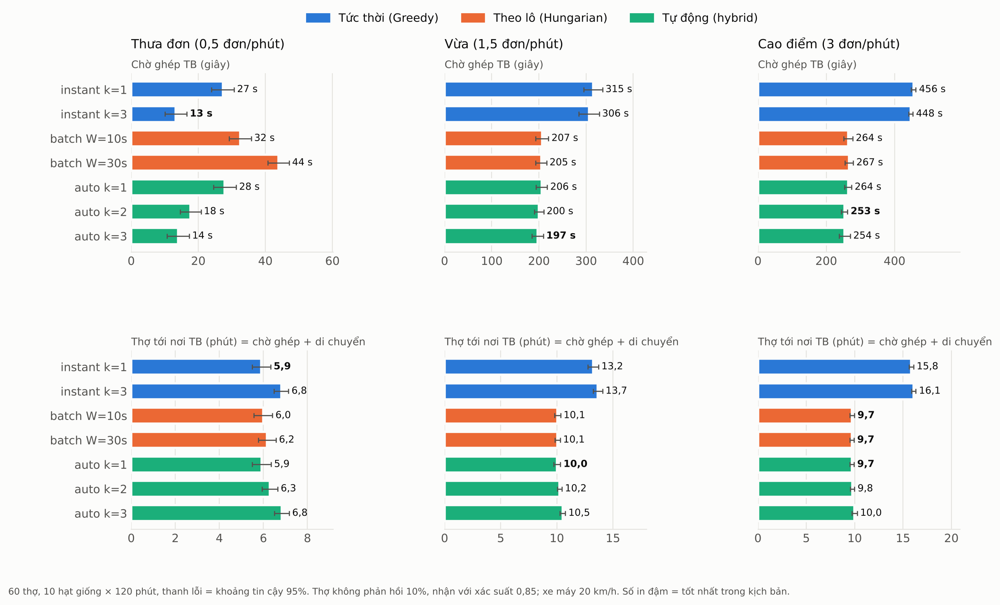

# Module ghép cặp thợ – đơn (Thành viên B)

Tài liệu này mô tả thuật toán ghép cặp và bộ điều phối đang chạy trong backend Node, cùng kết quả thực nghiệm dùng cho báo cáo.
Phạm vi nền tảng: **chỉ dịch vụ của thợ điện**. Danh mục là các nhóm chuyên môn trong nghề điện (Sửa chữa điện, Lắp đặt thiết bị điện, Đồ điện gia dụng, Đi dây & tủ điện).

## 1. Bài toán

Khách đặt một đơn sửa điện (làm ngay hoặc hẹn giờ). Hệ thống phải chọn thợ để mời, sao cho:

- khách có thợ **tới nơi** sớm (chờ ghép ngắn + thợ ở gần);
- thợ phù hợp: đúng nhóm chuyên môn, nhiều kinh nghiệm, đáng tin cậy, hay nhận đơn;
- việc được chia đều, không dồn cho một vài người;
- không vi phạm ràng buộc nghiệp vụ (hồ sơ chưa duyệt, đang bận, trùng lịch, nợ ví...).

Thợ là người thật nên có thể từ chối hoặc không trả lời. Vì vậy ghép cặp là một **quy trình theo thời gian**: mời, chờ, mời tiếp. Không phải chỉ chạy một phép tính là xong.

**Khách không chọn chế độ ghép.** Khách chỉ đặt đơn. Đơn được ghép bằng Greedy hay Hungarian là việc bên trong hệ thống. Admin chỉ chỉnh tham số ở cấu hình đang bật (bảng `matching_configs`). Trường `matching_mode` app khách gửi lên bị bỏ qua.

## 2. Ba bước cho mỗi đơn

```
 Bước 1: lọc không gian            Bước 2: ràng buộc cứng                  Bước 3: chấm điểm
 PostGIS ST_DWithin (GiST)   ──>   loại thợ không được phép nhận   ──>   Weighted Scoring 5 tiêu chí
 trong bán kính R của cấu hình      (bảng dưới)                            xếp giảm dần
```

**Bước 1** (`services/candidate.js`) dùng chỉ mục không gian trên `workers.current_location`. Nhờ đó không phải duyệt toàn bộ thợ. Hàm này dùng chung với trang "Mô phỏng" của web quản trị.

**Bước 2: ràng buộc cứng** (`dispatch.service.js › filterEligible`):

| Ràng buộc | Lý do |
|---|---|
| hồ sơ đã duyệt, tài khoản đang hoạt động | an toàn cho khách |
| có kỹ năng đúng **nhóm** của dịch vụ | thợ chỉ nhận việc mình làm được |
| trong bán kính R của cấu hình **và** bán kính nhận việc do thợ tự đặt (1–30 km) | tôn trọng lựa chọn của thợ |
| vị trí cập nhật trong 10 phút gần nhất (`LOCATION_MAX_AGE_MINUTES`) | không ghép theo vị trí cũ (thợ tắt GPS, mất mạng) |
| đang bật nhận đơn; với đơn làm ngay thì phải đang rảnh | đơn hẹn giờ vẫn mời được thợ đang bận việc khác |
| không đang giữ lời mời khác | mỗi thợ chỉ cân nhắc 1 lời mời một lúc |
| chưa từng được mời đơn này | đã từ chối hoặc bỏ lỡ thì không mời lại |
| ví không âm quá hạn mức (`WALLET_DEBT_LIMIT`, mặc định 500.000đ) | buộc nộp hoa hồng của đơn tiền mặt |
| không có lịch trùng trong ±120 phút (đơn hẹn giờ) | không nhận 2 lịch chồng nhau |

**Bước 3: hàm điểm** (`services/scoring.js`, `matching/scoring.js`):

```
S(thợ, đơn) = w_d·s_distance + w_t·s_trust + w_s·s_skill + w_a·s_acceptance + w_l·s_workload      (Σw = 1, S ∈ [0, 1])

s_distance   = 1 − d / R                         d: khoảng cách thật (PostGIS, mét), R: bán kính của cấu hình
s_trust      = trust_score ∈ [0, 1]               điểm tin cậy (thuật toán Trust Score – thành viên A)
s_skill      = min(số năm KN ở đúng nhóm, 10) / 10
s_acceptance = tỷ lệ nhận đơn 30 ngày (làm mượt Bayes, xem dưới)
s_workload   = 1 − min(số đơn trong ngày, 5) / 5  chia đều việc
```

Trọng số mặc định: khoảng cách 0,35 · tin cậy 0,30 · kỹ năng 0,15 · nhận đơn 0,10 · khối lượng 0,10. Admin sửa được ở web quản trị.
Khi hoà điểm, thợ gần hơn đứng trước. Nếu vẫn hoà thì thợ có id nhỏ hơn đứng trước, để kết quả ổn định và kiểm thử được.

**Thợ mới (cold start).** Thợ vừa được duyệt chưa có đơn nào, chưa có đánh giá, và `trust_score` chưa được tính (= 0). Nếu dùng nguyên số 0, thợ mới luôn xếp cuối và không bao giờ có đơn đầu tiên. Vì vậy khi ghép, những thợ này dùng mức trung tính `TRUST_COLD_START` = 0,5. Khi đã có lịch sử, hệ thống dùng điểm thật.

**Tỷ lệ nhận đơn** (`matching/stats.js`), cập nhật mỗi khi thợ trả lời hoặc lời mời hết hạn:

```
acceptance_rate = (nhận + 3) / (nhận + bỏ lỡ + 3)        trong 30 ngày
  nhận   = offer accepted, hoặc nhận rồi mới huỷ
  bỏ lỡ  = từ chối, hoặc để hết giờ không trả lời
  không tính: lời mời bị đóng sớm vì thợ khác đã nhận / khách huỷ / admin huỷ / thợ tắt nhận đơn
  +3     = "3 lần nhận ảo" (prior Bayes): thợ mới không bị tụt mạnh chỉ vì 1 lần lỡ
```

## 3. Ra quyết định: Greedy, Hungarian và chế độ tự động

| Chế độ | Cách làm | Ưu | Nhược |
|---|---|---|---|
| `instant`: Greedy top-k theo đợt | mỗi đơn xếp hạng ứng viên, mời k thợ điểm cao nhất cùng lúc; ai nhận trước được đơn; hết giờ thì mời đợt tiếp | gửi ngay, không chờ | các đơn đến gần nhau có thể "giành" nhau thợ tốt (tối ưu cục bộ) |
| `batch`: Hungarian theo lô | cứ W giây gom mọi đơn chờ × thợ rảnh thành ma trận điểm, giải bài toán gán tối ưu; mỗi đơn mời đúng 1 thợ | tối ưu tổng điểm toàn cục | đơn nào cũng phải chờ tới hết cửa sổ lô |
| `auto` (**mặc định**) | mỗi nhịp 2 giây, chia đơn đang chờ thành **nhóm tranh chấp** (Union-Find). Đơn đứng riêng thì dùng Greedy top-k; nhóm ≥ 2 đơn tranh cùng thợ thì dùng Hungarian trên nhóm | gửi gần như ngay (≤ 2 s) **và** tối ưu đúng chỗ có tranh chấp | chậm hơn instant tối đa 1 nhịp; đơn trong nhóm tranh chấp chỉ mời 1 thợ mỗi lượt |

**Hungarian** (`matching/hungarian.js`) là bản tự cài đặt Kuhn–Munkres, dùng thế vị và đường tăng ngắn nhất, độ phức tạp O(n²·m) (≈ O(n³)).
- Chi phí = 1 − điểm. Cặp không hợp lệ có chi phí BIG = min(n, m) + 1. Vì vậy lời giải ưu tiên **ghép được nhiều đơn nhất**, sau đó mới tới **tổng điểm lớn nhất**.
- Khi số đơn nhiều hơn số thợ, ma trận được chuyển vị.

**Vì sao chế độ auto đúng:**
- Hai nhóm không chung thợ nào thì giải riêng từng nhóm cho cùng kết quả với giải chung, mà ma trận lại nhỏ hơn.
- Nhóm chỉ có 1 đơn thì Hungarian trên 1 hàng chính là chọn thợ điểm cao nhất, tức Greedy. Vì vậy không có lý do bắt đơn đó chờ cửa sổ lô.
- Như vậy auto cho kết quả của Hungarian ở mọi chỗ có tranh chấp mà không tốn thời gian chờ lô. Đây là cách "hệ thống tự chọn chế độ tốt hơn" cho từng nhóm đơn, ở mỗi nhịp.

Chế độ thực tế đã dùng được ghi vào `orders.matching_mode` và `order_offers.mode` (`instant` | `batch`), để admin và báo cáo thống kê được.

**k (số thợ mời mỗi đợt), mặc định 1.**
- k lớn thì ghép nhanh hơn, vì ai nhận trước được đơn. Nhưng thợ nhận nhanh nhất thường không phải thợ gần nhất, nên khách phải chờ thợ tới lâu hơn và điểm phù hợp cũng thấp hơn. Ngoài ra nhiều thợ bị "mời hụt".
- Thực nghiệm ở mục 6 cho thấy k = 1 tốt nhất về thời gian thợ tới nơi ở mọi kịch bản. Admin vẫn có thể tăng k khi muốn khách thấy "đã có thợ nhận" sớm hơn.

## 4. Bộ điều phối chạy nền

```
khách tạo đơn ──> order_dispatches (hàng đợi, có hạn chót) ──> gửi lời mời ──> thợ nhận ──> accepted
                        ^                                         │
                        └──── từ chối / hết giờ / thợ tắt app ────┘   (không mời lại thợ cũ)
quá hạn chót mà chưa ai nhận ──> hệ thống huỷ đơn, báo khách
thợ huỷ khi chưa tới nơi     ──> đơn quay lại hàng đợi, tìm thợ khác
```

Mỗi nhịp `DISPATCHER_TICK_SECONDS` (mặc định 2 giây), file `services/matching/dispatcher.js` làm các việc sau:
1. đóng lời mời hết giờ, đóng lời mời của đơn đã huỷ, nhận các đơn chưa vào hàng đợi;
2. instant: gửi đợt mời tiếp cho đơn tới lượt;
3. auto: nhóm tranh chấp → Greedy / Hungarian. batch: đủ `batch_window_seconds` thì chạy một lượt Hungarian;
4. huỷ đơn quá hạn chót. Ngoài ra, cứ 10 giây đồng bộ cờ bận, cứ 30 giây nhắc thợ trước giờ hẹn 60 phút.

Hạn chót của đơn:
- đơn làm ngay: 15 phút (`DISPATCH_MAX_WAIT_MINUTES`);
- đơn hẹn giờ: tới 15 phút trước giờ hẹn.

**Chạy nhiều tiến trình vẫn an toàn:**
- Chỉ một tiến trình làm leader, bằng khoá advisory phiên 815000 của PostgreSQL.
- Mọi thao tác ghép chạy tuần tự dưới khoá giao dịch 815001, nên 2 đơn không thể cùng giành 1 thợ.
- Khi thợ bấm nhận, hệ thống khoá dòng đơn: ai tới trước được đơn, người tới sau nhận lỗi 409.

**Thợ được báo ngay** qua Socket.IO bằng sự kiện `offer:new` / `offer:closed`, kèm thông báo đẩy. App vẫn hỏi định kỳ để dự phòng khi mất kết nối.

## 5. Cấu hình

| Tham số (`matching_configs`) | Mặc định | Ý nghĩa |
|---|---|---|
| `w_distance … w_workload` | 0,35 / 0,30 / 0,15 / 0,10 / 0,10 | trọng số hàm điểm |
| `max_radius_km` | 10 | bán kính tìm thợ R |
| `offer_timeout_seconds` | 30 (seed demo: 60) | thời gian thợ trả lời một lời mời |
| `mode` | `auto` | `instant` / `batch` / `auto` |
| `max_offers` | 1 | k: số thợ mời cùng lúc mỗi đợt (instant, auto) |
| `batch_window_seconds` | 10 | cửa sổ gom lô (chỉ chế độ batch) |

Đổi nhanh khi demo: `PUT /api/admin/dispatch/mode { mode, max_offers }`. Xem trạng thái vòng điều phối: `GET /api/admin/dispatch/status`.
Biến môi trường liên quan: `DISPATCHER_ENABLED`, `DISPATCHER_TICK_SECONDS`, `LOCATION_MAX_AGE_MINUTES`, `DISPATCH_MAX_WAIT_MINUTES`, `TRUST_COLD_START`, `WALLET_DEBT_LIMIT` (xem `.env.example`).

## 6. Thực nghiệm

Chạy lại: `npm run benchmark -- --out ket-qua` (khoảng 15 giây). Kết quả đầy đủ (CSV + Markdown) nằm trong `docs/thuc-nghiem/`.
Script dùng **đúng** hàm điểm, Hungarian, Greedy và Union-Find mà hệ thống đang chạy, chỉ thay CSDL bằng dữ liệu sinh ngẫu nhiên có hạt giống.

### 6.1. Bài toán gán tĩnh: Greedy theo thứ tự đến và Hungarian

Mỗi lần thử có n đơn và n thợ rải ngẫu nhiên trong bán kính 8 km, R = 5 km, thông số thợ ngẫu nhiên.

| n | Greedy tổng điểm | Hungarian tổng điểm | Hungarian hơn | cặp ghép được (Greedy → Hungarian) | Hungarian (ms) |
|---|---|---|---|---|---|
| 10 | 5,321 | 5,748 | +8,0 % | 7,6 → 8,3 | 0,04 |
| 25 | 15,727 | 17,307 | +10,1 % | 21,8 → 24,3 | 0,12 |
| 50 | 34,105 | 37,037 | +8,6 % | 46,2 → 50 | 0,38 |
| 100 | 72,334 | 77,445 | +7,1 % | 94,8 → 100 | 2,2 |
| 150 | 111,158 | 117,515 | +5,7 % | 144 → 150 | 4,3 |
| 200 | 151,223 | 159,547 | +5,5 % | 193,2 → 200 | 7,1 |

Hungarian luôn ghép được nhiều đơn hơn, tổng điểm cao hơn 5,5–10 %, và chạy khoảng 7 ms với 200 × 200 (thời gian lấy nhỏ nhất của 5 lần chạy lại mỗi ma trận). Như vậy nó đủ nhanh để chạy trong mỗi nhịp 2 giây.


### 6.2. Mô phỏng vận hành

Mô phỏng sự kiện rời rạc, bước 1 giây, với 60 thợ trong thành phố bán kính 8 km. Đơn đến theo phân phối Poisson.
- Thợ: 10 % không phản hồi (lời mời hết hạn sau 60 s). Số còn lại trả lời sau 3–25 s và nhận với xác suất 0,85. Thợ đi xe máy 20 km/h, mỗi việc sửa mất 30–90 phút.
- Đơn: chờ tối đa 15 phút.
- Chạy 10 hạt giống, mỗi lần 120 phút, báo cáo trung bình ± khoảng tin cậy 95 %.
- Mọi cấu hình dùng **cùng** dòng đơn và **cùng** phản ứng của từng thợ với từng đơn, nên so sánh là công bằng.

"Tới nơi" = thời gian chờ ghép + thời gian thợ di chuyển. Đây là thời gian khách thực sự phải đợi.



| Kịch bản | Cấu hình | Tỷ lệ ghép | Chờ ghép TB | Điểm TB | Quãng đường TB | **Tới nơi TB** |
|---|---|---|---|---|---|---|
| Thưa đơn (0,5 đơn/phút) | instant k=1 | 99,9 % | 27,3 s | 0,766 | 1,82 km | 5,91 phút |
| | instant k=3 | 100 % | 13,3 s | 0,734 | 2,19 km | 6,81 phút |
| | batch W=10 s | 99,9 % | 32,5 s | 0,766 | 1,82 km | 5,99 phút |
| | batch W=30 s | 99,9 % | 43,9 s | 0,766 | 1,81 km | 6,17 phút |
| | **auto k=1** | 99,9 % | 27,9 s | 0,766 | 1,82 km | **5,92 phút** |
| | auto k=3 | 100 % | 14,0 s | 0,734 | 2,20 km | 6,83 phút |
| Vừa (1,5 đơn/phút) | instant k=1 | 71,9 % | 315 s | 0,678 | 2,66 km | 13,23 phút |
| | batch W=10 s | 71,9 % | 207 s | 0,710 | 2,20 km | 10,06 phút |
| | **auto k=1** | 71,9 % | 206 s | 0,710 | 2,20 km | **10,02 phút** |
| | auto k=3 | 71,4 % | 197 s | 0,695 | 2,41 km | 10,52 phút |
| Cao điểm (3 đơn/phút) | instant k=1 | 38,3 % | 456 s | 0,668 | 2,75 km | 15,85 phút |
| | instant k=3 | 38,0 % | 448 s | 0,659 | 2,88 km | 16,11 phút |
| | batch W=10 s | 39,3 % | 264 s | 0,736 | 1,77 km | 9,73 phút |
| | **auto k=1** | 39,4 % | 264 s | 0,736 | 1,78 km | **9,73 phút** |
| | auto k=3 | 39,1 % | 254 s | 0,726 | 1,92 km | 9,99 phút |

Hai kịch bản "vừa" và "cao điểm" cố ý vượt sức chứa của 60 thợ. Vì vậy tỷ lệ ghép bị giới hạn bởi số thợ và gần như như nhau giữa các cách. Điểm khác nhau nằm ở **ai được ghép với ai**.

### 6.3. Độ nhạy theo tỷ lệ thợ không phản hồi (chế độ auto)

| Không phản hồi | Thưa đơn: tới nơi k=1 / k=2 / k=3 | Thưa đơn: chờ ghép k=1 / k=3 | Cao điểm: tới nơi k=1 / k=2 / k=3 |
|---|---|---|---|
| 0 % | **5,67** / 6,11 / 6,82 phút | 20,4 / 12,6 s | **9,49** / 9,64 / 9,86 phút |
| 10 % | **5,92** / 6,29 / 6,83 phút | 27,9 / 14,0 s | **9,73** / 9,76 / 9,99 phút |
| 30 % | **6,68** / 6,85 / 7,02 phút | 51,5 / 20,7 s | **10,06** / 10,24 / 10,21 phút |

### 6.4. Kết luận

1. **auto lấy được ưu điểm của cả hai chế độ.**
   - Khi thưa đơn, auto nhanh ngang instant (27,9 s so với 27,3 s) và không phải chờ cửa sổ lô như batch (W = 30 s chờ 43,9 s).
   - Khi đông đơn, auto đạt chất lượng ngang batch: điểm 0,736 so với 0,668 của instant, quãng đường 1,78 km so với 2,75 km, thợ tới nơi 9,7 phút thay vì 15,9 phút.
2. **Ghép tốt còn tăng sức chứa.** Thợ đi quãng ngắn hơn thì rảnh sớm hơn. Vì vậy lúc cao điểm instant ghép được ít đơn hơn và mỗi đơn chờ lâu hơn hẳn (456 s so với 264 s).
3. **Cửa sổ lô lớn không đáng.** Tăng W từ 5 lên 30 giây hầu như không tăng điểm, chỉ làm khách chờ thêm. Đó là lý do auto chạy theo nhịp 2 giây thay vì gom lô.
4. **Chọn k = 1.**
   - Mời nhiều thợ cùng lúc rút ngắn thời gian chờ ghép (khi thưa đơn, k=3 nhanh hơn khoảng 14 giây). Nhưng thợ thắng thường ở xa hơn, nên khách đợi thợ tới lâu hơn 0,3–1 phút, và điểm phù hợp cũng thấp hơn.
   - Kết luận này giữ nguyên khi thợ không phản hồi 0 %, 10 % hay 30 %.
   - Đổi lại, k = 1 có đuôi chờ ghép dài hơn: khi thưa đơn, P90 là 66 s so với 20 s.

**Giới hạn của mô phỏng:**
- dùng khoảng cách đường chim bay và tốc độ cố định;
- thời gian phản hồi không phụ thuộc khoảng cách;
- thợ phân bố đều trong thành phố;
- không mô phỏng huỷ sau khi nhận.

Các con số dùng để so sánh tương đối giữa các cách ghép, không phải dự báo vận hành thật.

## 7. Kiểm thử

- `npm run test:algo`: Hungarian so với vét cạn trên ma trận ngẫu nhiên, ô không hợp lệ, ma trận chữ nhật; Union-Find; Greedy.
- `npm test`: chạy trên PostgreSQL/PostGIS thật, đi qua API của app thợ, app khách và admin. Bao gồm:
  - từ chối thì mời đợt sau; hết giờ; quá hạn thì huỷ; thợ tắt app thì lời mời chuyển cho thợ khác;
  - thợ huỷ thì đơn quay lại hàng đợi;
  - batch, auto (nhóm tranh chấp → Hungarian, đơn đứng riêng → Greedy);
  - đơn hẹn giờ, trùng lịch;
  - lọc kỹ năng, bán kính, vị trí cũ; cold start;
  - khách / admin huỷ thì app thợ được báo ngay;
  - realtime.

## 8. Mã nguồn

| File | Nội dung |
|---|---|
| `src/matching/hungarian.js` · `greedy.js` · `grouping.js` · `scoring.js` | thuật toán thuần, không phụ thuộc CSDL |
| `src/services/candidate.js` · `src/services/scoring.js` | lọc không gian, tiêu chí điểm (dùng chung với trang Mô phỏng của admin) |
| `src/services/matching/dispatch.service.js` | hàng đợi, ràng buộc cứng, gửi lời mời, Greedy / Hungarian / auto, nhận / từ chối / hết hạn |
| `src/services/matching/dispatcher.js` | vòng chạy nền, leader |
| `src/services/matching/stats.js` · `config.js` | tỷ lệ nhận đơn, cấu hình đang bật |
| `scripts/benchmark-matching.js` | thực nghiệm |
